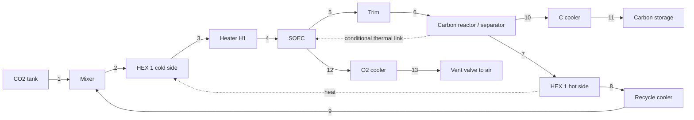

# Charging 담당 설계·검산 가이드

## 1. 담당 범위와 산출물

과제의 charging 담당은 **CO₂ → C(s)+O₂의 정상상태 공정 모델, 에너지 부하와 개선안**을 설계합니다.
탄소는 저장하고 O₂는 25°C까지 냉각한 뒤 밸브로 대기에 방출합니다. 산소 판매/저장 에너지나 방출열에 효율 credit을 주지 않습니다.

| 해야 할 일 | 결정·계산할 내용 | 제출할 증거 |
|---|---|---|
| 시스템 경계·기준 | 1 kmol/s CO₂, 5 bar, 25°C, 단위·부호 | 조건표, 공정도 |
| 재순환 루프 | SOEC 전환율 0.70, purge 없음, 탄소 완전 분리 | ξ·b·a 유도, 모든 스트림 유량 |
| Boudouard 반응기 | 650°C 평형, C 활동도 1 | K_B, y_CO7, 반응기 열부하 |
| SOEC | 850°C, 스트림 5·12 Nernst, +0.10 V 손실 | E₀, E_rev, V_ch, I, W_cell, Q_cell, V_tn |
| HEX 1 | 7→8 열을 2→3에 전달, ε=0.85 | Q_max, Q, T₃/T₈, 내부 T–Q 곡선 |
| 히터·열조절·냉각 | H1, 5→6, 8→9, 10→11, 12→13 | Q 및 Qel/Qrej를 분리한 장치표 |
| thermal link | 셀↔반응기만, donor−receiver≥20 K | 적격 여부, min(0.85|Qdonor|,Qreceiver) |
| 전체 수지·효율 | Pin=Wcell+ΣQel, ηch=nC·LHV/Pin | 원소/에너지 잔차, 충전 효율 |
| 과제 (d),(e) | 압력 1·2·5·10 bar, 셀 750·800·850·900°C | 각각 (a)~(c) 표와 경향 설명 |
| 개선 논의 (f) | 허용 가정에서의 변화와 추가 설계안 구분 | 기준 대비 개선량·불리한 변화·물리 제약 |
| 통합 연결 | R 구조체 유지, 같은 탄소 재고 | 팀 통합 main과 재현 결과 |

충전 모델에는 공기 압축기와 CO₂ 분리기 전력을 넣지 않습니다. 이 두 장치는 방전 담당입니다.
왕복 효율은 통합 담당과 연결해야 하며 충전 결과만으로 확정할 수 없습니다.

## 2. 공정 연결



그림의 thermal link 화살표는 가능한 경로입니다. 기준 충전 조건에서는 **전달량이 0**입니다.

| 스트림 | 조성/관계 | 온도 |
|---|---|---|
| 1 | 순수 CO₂, 1 kmol/s | 25°C |
| 2·3·4 | 1+9, 조성 고정 | 25°C / HEX 계산값 / Tcell |
| 5·6 | SOEC 연료극 CO/CO₂, 조성 고정 | Tcell / TB,ch |
| 7·8·9 | 반응기 출구 CO/CO₂, 전량 재순환 | TB,ch / HEX 계산값 / 25°C |
| 10·11 | 완전 분리한 C(s) | TB,ch / 25°C |
| 12·13 | 순수 O₂ | Tcell / 25°C |

**번호가 붙은 1–13은 모두 P입니다.** 13은 방출 밸브 전이며 밸브 후 대기는 1 bar입니다(PDF Figure 2의 명시). 번호 13을 1 bar로 바꾸지 않습니다.
PDF p. 4는 Nernst 평가에 “inlet”이라고 적었지만 번호는 5·12를 지정합니다. Figure 2에서 이들은 출구입니다. 구현은 구체적 번호 **5·12**를 따릅니다. 발표에 이 해석을 명시하고 필요하면 담당 교수에게 문구를 확인하십시오.

## 3. 손계산으로 고정할 물질수지

`F=nCO2,1`, `X=Xsoec`, `a=nCO,2`, `b=nCO2,2`, `ξ=nC,10`로 둡니다. 단위는 kmol/s.

```text
SOEC:       nCO,5 = a + Xb           nCO2,5 = (1−X)b
            nO2,12 = Xb/2
반응기:     nCO,7 = a + Xb − 2ξ     nCO2,7 = (1−X)b + ξ
재순환:     n7 = n9
혼합기:     a = a + Xb − 2ξ         b = F + (1−X)b + ξ
따라서:     ξ = F                   Xb = 2F
            b = 2F/X                c ≡ nCO2,7 = b−F
```

기준값은 **ξ=1, Xb=2, b=20/7, c=13/7**입니다. 전체 생성 O₂도 1 kmol/s입니다.
CO₂를 한 번만 전환하는 70%와 전체 탄소 회수율을 혼동하지 마십시오. 완전 재순환·무퍼지 정상상태에서는 신선 공급 탄소가 모두 저장됩니다.

```text
ΔG°B(T) = g°C + g°CO2 − 2g°CO
K_B = exp(−ΔG°B / RuT)
K_B = [yCO2·P/p°] / [yCO·P/p°]²
    = c(a+c) / [a²(P/p°)]
k = K_B(P/p°)
a = c[1 + sqrt(1+4k)]/(2k)
```

흑연의 활동도는 1이고 고체 유량은 기체 몰분율 분모에 포함하지 않습니다.
충전 반응의 총 몰수는 보존되지 않으므로 총 몰유량 보존을 검사하면 안 됩니다. 보존량은 C/O/N 원자 또는 질량입니다.

기준 독립 계산: K_B=3.10242931, a=0.53517546 kmol/s, yCO,7=0.22370579.

## 4. 전기화학과 열부하

```text
E0 = −(g°CO2 − g°CO − 0.5g°O2)/(2F_Faraday·1000)
Erev = E0 + (Ru·Tcell)/(2F_Faraday·1000)
                ·ln[(pCO,5/p°)sqrt(pO2,12/p°)/(pCO2,5/p°)]
Vch = Erev + 0.10
I_equiv = 2F_Faraday·1000·Xb = 4F_Faraday·1000·F
Wcell = I_equiv·Vch
```

여기서 `F_Faraday=96485 C/mol`, `Ru=8314 J/(kmol K)`입니다. kmol→mol 변환을 누락하면 전류·전력이 1000배 틀립니다.
`I_equiv=385.94 MA`는 1 kmol/s 탄소 기준 전체 활성 셀의 **합산 등가 전류**입니다. 단일 stack의 단자전류를 정한 값이 아닙니다. 직렬 셀 수와 병렬 stack, 전류밀도가 있어야 실제 전압·전류·면적을 배분할 수 있습니다.

`Hk = Σ ni,k hi(Tk)`로 계산하고, 생성엔탈피를 포함한 Cantera 엔탈피를 사용합니다.
**별도의 반응열을 다시 더하지 않습니다.**

| 장치 | 장치로 들어가는 열 Q [W] |
|---|---|
| Heater H1 | H4−H3 |
| SOEC | H5+H12−H4−Wcell |
| Trim 5→6 | H6−H5 |
| 반응기/고체 분리기 | H7+H10−H6 |
| 재순환 냉각기 | H9−H8 |
| 탄소 냉각기 | H11−H10 |
| 산소 냉각기 | H13−H12 |

`Vtn=(H5+H12−H4)/I`. 기준값 Vtn≈1.46210 V > Vch≈1.14918 V이므로 SOEC는 흡열(+120.769 MW)입니다.
전압 손실은 이미 Vch에 들어갔으므로 별도의 `I·0.10 V` 열손실을 다시 더하지 않습니다.
히터/trim의 Q가 음수가 되는 변형 조건도 가능하므로 부호대로 냉각으로 분류해야 합니다.

## 5. 열교환·열회수 검산

```text
Qmax,h = H(n7,TB) − H(n7,T2)
Qmax,c = H(n2,TB) − H(n2,T2)
Qhex   = ε·min(Qmax,h,Qmax,c)
H8     = H7 − Qhex           H3 = H2 + Qhex
```

반응열/화학엔탈피를 회수열로 혼동하지 않도록 각 유체의 **같은 조성**으로 온도만 바꿔 Qmax를 구합니다.
상수 cp 근사를 쓰지 않고 엔탈피를 역산해 T₃와 T₈을 얻습니다.
향류의 같은 위치는 저온 입구 끝에서 `Hcold=H2+q`, `Hhot=H8+q`입니다.
201점에서 `Thot−Tcold>0`를 검사하고 HEX 전체 엔트로피 생성률도 음수가 아닌지 확인합니다.
샘플링은 연속 구간의 엄밀한 최소화 증명이 아닙니다. 최소 온도차가 작아지는 개선안은 격자 세분화/최소화와 실제 설계 여유를 추가하십시오.

thermal link는 다음을 **모두** 만족해야 합니다.

1. donor의 원래 Q<0, receiver의 원래 Q>0.
2. donor 온도−receiver 온도≥20 K.
3. 경로가 셀↔Boudouard 반응기.
4. Qlink=min(0.85·|Qdonor|,Qreceiver).

기준 충전에서 반응기 650°C→셀 850°C는 2번을 만족하지 않습니다. **171 MW의 반응열이 있어도 셀 전기가열에서 뺄 수 없습니다.**
잔여 양의 부하는 100% 전기 저항 가열, 잔여 음의 부하는 방출입니다.
HEX 열은 이미 H3/H8에 반영되었으므로 Pin에서 다시 빼면 이중 계산입니다.

## 6. 어떤 기준으로 ‘잘 설계됐다’고 판단하나

**수학적 타당성 → 과제 조건 준수 → 물리적 가능성 → 성능/개선** 순서로 판단합니다.

| 검사 | 합격 조건/방법 |
|---|---|
| 입력·결과 | 유한 실수, 유량≥0, 압력>0, 0<Xsoec<1 |
| 혼합·재순환 | 1+9=2, 7→8→9 조성 동일, 모든 수동 장치 조성 동결 |
| 반응·원소 | 셀 및 반응기 화학양론과 각 장치 C/O/N 잔차 |
| 평형 | abs(ln K−ln 반응지수)≤1e−8 |
| 전류·전압 | 원시 스트림으로 전환량·전압 재계산, 1000 변환·전압 손실 부호 검사 |
| 장치 에너지 | ΣHin+Q+W−ΣHout≈0, 전력 기준 상대 허용오차 병용 |
| 전체 에너지 | H1+Pin−Qrej−H11−H13≈0 |
| 열회수 | HEX 두 유체 Q 일치, 유용도, 내부 온도차>0, thermal link 조건/상한 |
| 효율 | ηch=nC·393.5e6/Pin, 같은 탄소 재고로 방전 시간 연결 |
| 독립 대조 | Python에서 평형을 별도 수치해로 계산하고 MATLAB JSON과 비교 |
| 오류 검출 | 탄소 유량·전류 단위·불가능한 link·전압 부호·HEX 중복 차감을 변조하여 실패 확인 |

MATLAB 검증기의 원소 허용오차: `1e−9 + 1e−8·max(abs(n))` kmol/s.
에너지 허용오차: `0.1 + 1e−8·max(abs(Pin),abs(Q),1)` W.
온도 지정값 허용오차는 1e−5 K, 압력 1e−4 Pa입니다. 이들은 **계산 검증 허용오차**이며 제작 공차/안전계수가 아닙니다.

수지표의 에너지 잔차가 0인 것만으로 충분하지 않습니다. Q를 엔탈피 차로 정의했으면 틀린 모델도 스스로 수지를 닫을 수 있습니다.
그래서 평형·스트림 지정·전류·열전달 방향과 독립 계산을 함께 검사합니다.
Cantera의 25°C 반응 엔탈피와 과제의 반올림된 LHV=393.5 kJ/mol은 미세하게 다릅니다.
**에너지 닫힘에는 실제 엔탈피 차, 보고용 효율에는 지정 LHV**를 쓰십시오.

## 7. 기준 계산과 경향

아래는 독립 참고 코드에서 실행한 **Python 3.11 / Cantera 3.0.0** 결과입니다. MATLAB 실행값으로 표기하지 마십시오.

| 항목 | 기준값 |
|---|---:|
| 탄소 저장률 / O₂ 방출률 | 각각 1 kmol/s |
| Stream 3 / 8 온도 | 412.554 / 134.049°C |
| Erev / Vch / Vtn | 1.049178 / 1.149178 / 1.462099 V |
| 셀 입력 전력 | 443.514 MW |
| H1 / SOEC 전기가열 | 73.676 / 120.769 MW |
| 반응기 열부하 | −171.344 MW |
| Trim 열부하 | −26.228 MW |
| HEX1 회수열 | 54.905 MW |
| Thermal link | 0 MW |
| 총 입력 Pin / 총 방출열 | 637.959 / 244.451 MW |
| 충전 효율 | 61.6811% |
| HEX 최소 온도차(201점) | 109.049 K |

압력이 오르면 석출 평형상 CO가 줄어 재순환 유량과 예열 부하가 줄고 ηch가 소폭 증가합니다.
이는 방전 압축기 손실을 포함한 왕복 효율 경향과 다를 수 있습니다.
셀 온도 스윕에서는 반응기 온도를 고정하므로 충전 평형과 재순환 조성이 그대로입니다. 셀 온도가 높아지면 예열 등 총 입력이 늘어 ηch가 감소합니다.
기준 흡열·link 미작동 구간에서는 dV_loss를 낮춰도 줄어든 Wcell만큼 Qcell 전기가열이 늘어 Pin은 같습니다. ‘전압 손실 감소=충전 효율 상승’으로 단정하지 않습니다.

## 8. 개선안과 추가 장치 설계의 경계

- 우선 비교할 개선안: HEX 유용도 변화, SOEC 전환율 변화, 충전 반응기 온도 변화. 탄소 처리량과 공통 시스템 조건을 고정해 비교합니다.
- TB,ch=870°C에서는 Tcell=850°C와 20 K 차로 link가 가능해질 수 있습니다. 동시에 CO 재순환량과 장치 크기 부담이 커집니다. 열회수 증가만 보지 말고 Pin·ηch·순환량·최소 온도차를 함께 제시합니다.
- 반응기 열로 H1을 예열하는 추가 경로는 **과제의 기본 셀↔반응기 link에 포함되지 않습니다.** 개선 제안으로 별도 공정도·온도 구간·열수지를 정의해야 합니다.
- 충전 기간의 잔열을 방전 기간으로 넘기는 계산은 기본 과제에서 허용되지 않습니다. 열저장 장치를 새로 설계하는 대안이라면 기준 결과와 분리해야 합니다.
- 실제 HEX 면적은 U·LMTD 또는 ε–NTU와 형상/압력강하가 필요합니다. Q만으로 확정할 수 없습니다.
- 실제 반응기 체적은 반응속도·체류시간·전달현상·고체 배출 설계가 필요합니다. 평형 도달 가정만으로 체적을 정할 수 없습니다.
- 셀 총 활성면적의 시작식은 A_total=I_equiv/j입니다. 과제는 전류밀도 j나 stack 구성을 주지 않아 수치 설계값을 임의로 넣지 않았습니다.

발표용 권장 구성: ①충전 공정/경계 ②물질수지·평형 유도 ③스트림표 ④열부하·전력/회수 분리 ⑤검산 잔차·HEX T–Q ⑥압력/온도 스윕 ⑦개선안과 통합 효율.

## 근거

- 사용자 제공 과제 PDF pp. 2–3: charging 공정, Figure 2 및 스트림 조건.
- PDF p. 4: 물성, 평형, thermal link, 전압과 모델 가정.
- PDF p. 6: (a)~(f), 같은 탄소 재고, 단일 main 재현 요구.
- [확인한 저장소 revision](https://github.com/Woojeong-2026/Energy-System-Design/tree/fb28621885af0df18ac6d20412ad4db788992efe): `noon_config.m`, `modes/charging_mode.m`, `thermo/`, `system/`, `main.m`.
