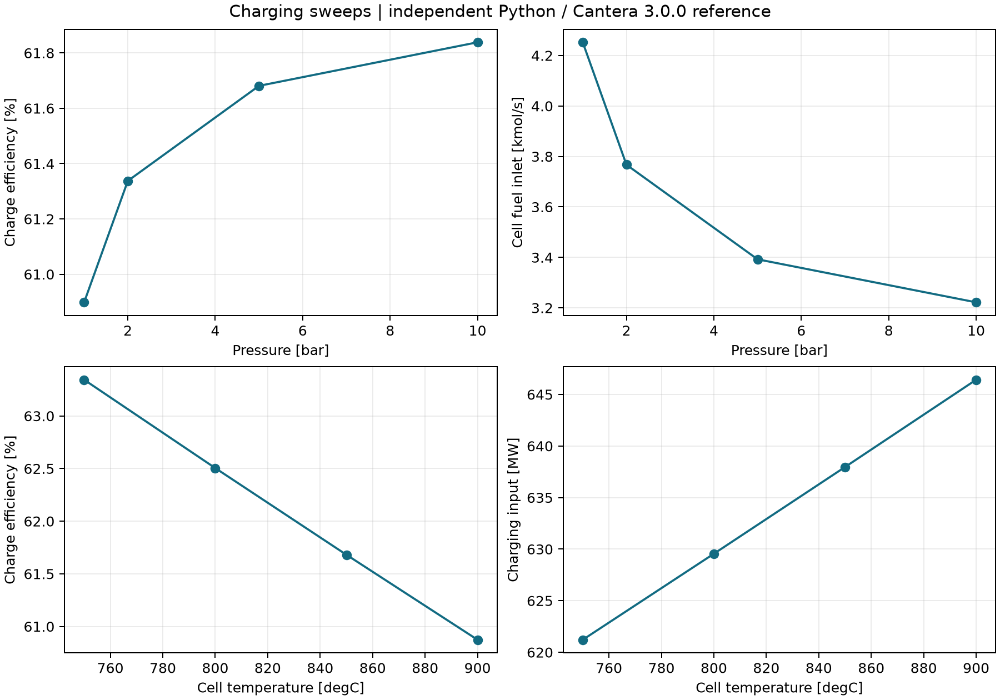
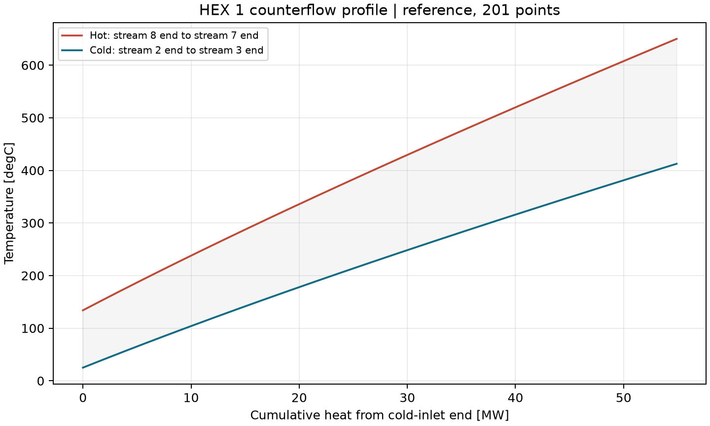

# 검증 결과와 남은 확인

검증 갱신일: 2026-11-18 (한국 시간). 원본 모델 revision: `fb28621885af0df18ac6d20412ad4db788992efe`.
첨부 과제 PDF와 코드의 charging 범위를 대조했습니다.

## 판단

검토한 식·경계조건은 과제의 정상상태 충전 공정과 일치합니다. 독립 Cantera 계산값도 README의 반올림 참고 수치와 일치합니다.
따라서 기존 충전 모델을 버리기보다 **입력 검증과 원시 출력의 재검산을 보강**하는 방향을 택했습니다.
`modes/charging_mode.m`은 기존 모델의 물리식/인터페이스를 유지합니다. 기존 코드 기여와 추가한 검증 코드는 [지침서](CHARGING_STUDY_GUIDE_KO.md)의 연결 설명에 구분했습니다.

이 판단은 MATLAB에서 충전 코드를 실행해 성공했다는 뜻이나, 최적 공정/실제 제작 설계가 완료됐다는 뜻은 아닙니다.

## 실제 수행

| 구분 | 결과 |
|---|---|
| PDF와 원본 코드 검토 | 완료: 조성, 번호, 전압, 단위, 회수 조건, 경계, 효율 |
| Python 런타임 | Python 3.11.18, Cantera 3.0.0, NumPy 1.26.4 |
| 기준+필수 압력/온도 | 9개 케이스, 각 46개 수치 검사 통과 |
| Python 회귀·오류 주입 | 8개 test method 통과(여러 subtest 포함) |
| MATLAB 소스 정적 검사 | MISS_HIT 0.9.44, 6개 .m 파일, 오류/경고 없음 |
| 그림 | pressure/cell-temperature 스윕 및 HEX 내부 T–Q PNG 생성·열람 확인 |
| MATLAB/Cantera toolbox 실행 | **미실행**: 이 환경에 MATLAB 없음 |
| MATLAB 출력과 Python 비교 | **미실행**: MATLAB raw.json을 만든 뒤 실행 필요 |
| 통합 방식 | 기존 charging 함수에 입력 검사 추가, main_charging과 검산·독립 계산·문서 추가 |

JSON 대조 CLI는 Python 기준 JSON으로 입출력 경로를 시험했습니다. 이것을 MATLAB 대조 성공으로 계산하지 않았습니다.
원본 README도 Python 참고값이라고 밝히고 있으므로, README와의 일치가 MATLAB 실행을 대신하지 않습니다.
정적 검사는 문법/일부 코드 문제를 확인하며 Cantera API의 런타임 동작을 보증하지 않습니다.

## 독립 계산 결과

| 케이스 | Pin [MW] | ηch [%] | n4 [kmol/s] | Vch [V] |
|---|---:|---:|---:|---:|
| 기준 5 bar, 850°C | 637.9587 | 61.6811 | 3.3923 | 1.14918 |
| 1 bar | 646.1573 | 60.8985 | 4.2525 | 1.12437 |
| 2 bar | 641.5321 | 61.3375 | 3.7672 | 1.13368 |
| 5 bar | 637.9587 | 61.6811 | 3.3923 | 1.14918 |
| 10 bar | 636.3338 | 61.8386 | 3.2218 | 1.16258 |
| 셀 750°C | 621.2116 | 63.3440 | 3.3923 | 1.18604 |
| 셀 800°C | 629.5531 | 62.5047 | 3.3923 | 1.16758 |
| 셀 850°C | 637.9587 | 61.6811 | 3.3923 | 1.14918 |
| 셀 900°C | 646.4245 | 60.8733 | 3.3923 | 1.13082 |

9개 중 기준·P5·T850은 의도적으로 같은 조건을 별도 저장했습니다. 서로 다른 조건은 총 7개입니다.
각 압력 스윕은 Tcell=850°C, 각 셀 온도 스윕은 P=5 bar이며 TB,ch=650°C를 유지합니다.

기준 전체 에너지 잔차: 약 −1.95×10⁻⁵ W. 9개 케이스 전체 에너지 잔차 절댓값 최대 약 4.23×10⁻⁵ W.
기준 HEX 엔트로피 생성률: 약 30.140 kW/K ≥ 0. 최소 온도차: 109.049 K.
Cantera의 25°C 저장 반응 엔탈피는 약 393.507750 MW, 효율 계산의 지정 LHV 유량은 393.500000 MW입니다.
그 차이 약 7.75 kW를 수지 오류나 추가 손실로 분류하면 안 됩니다.

## 시험이 확인한 오류

- 탄소 저장 유량을 1→0.9 kmol/s로 변경하면 실패.
- 등가 전류를 1000으로 나눠 kmol/mol 변환을 누락하면 실패.
- 기준 조건에 불가능한 thermal link 1 MW를 기록하면 실패.
- Vch에서 손실 부호를 바꾸면 실패.
- 이미 반영된 HEX 회수열을 Pin에서 또 빼면 실패.
- 잘못된 배열 크기, NaN, 필수 config 누락은 오류로 거부.
- 유량 0.01/2/10배: 전력은 유량 비례, 효율은 동일.
- TB,ch=869.999°C와 870°C: 20 K 조건에 따라 link off/on.
- ε=0: Qhex=0, 예열 이득 소멸, 입력 전력 증가.
- Xsoec=0 또는 1, 음압, 영유량, 유용도>1, 표준압력 불일치 등을 거부.

## 사용자 MATLAB에서 마지막으로 할 일

1. 저장소 루트에서 `main_charging`을 실행.
2. `results/charging_review/summary.csv`와 각 케이스의 검사표를 확인.
3. 각 케이스 `raw.json`을 Python `--compare`에 넣어 대조.
4. 기존 전체 `main`으로 방전·왕복 효율을 포함한 통합 결과 재생성.
5. 발표에는 MATLAB 결과표와 검산 CSV를 사용하고, 개선안에는 기본 가정에서 바뀐 조건을 명시.

한 케이스라도 실패하면 해당 `independent_checks.csv`/`comparison.csv`의 항목부터 확인합니다.
수지 검사 통과 후에도 cell current density, reaction kinetics, HEX area와 같은 실제 장치 정보는 별도 설계가 필요합니다.

## 재현 증거 파일

[Python 시험 로그](reference_results/python_tests.txt), [MATLAB 정적 검사 로그](reference_results/matlab_static_lint.txt), [9개 케이스 요약](reference_results/summary.csv), [기준 수지 검사](reference_results/base_checks.csv)를 함께 저장했습니다. 인터랙티브 학습의 22개 계산과 6개 오류 시나리오는 [학습 검증 기록](interactive/lesson_verification.json)에서 확인합니다.

