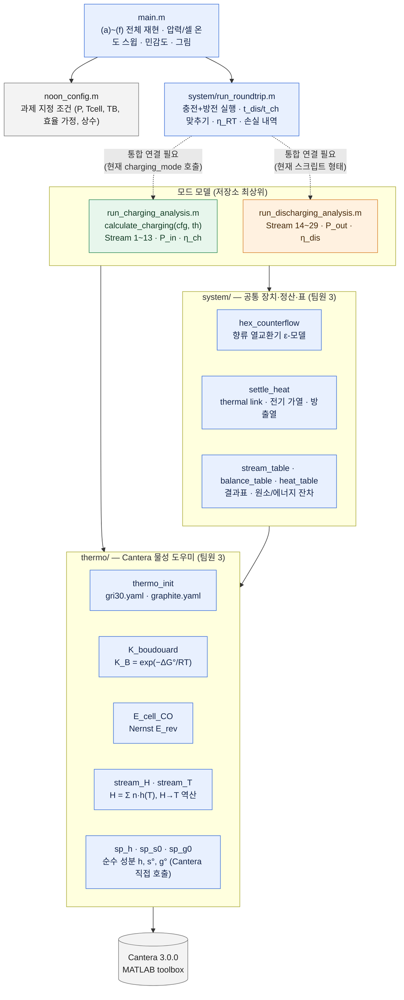
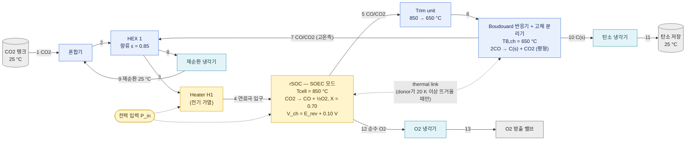
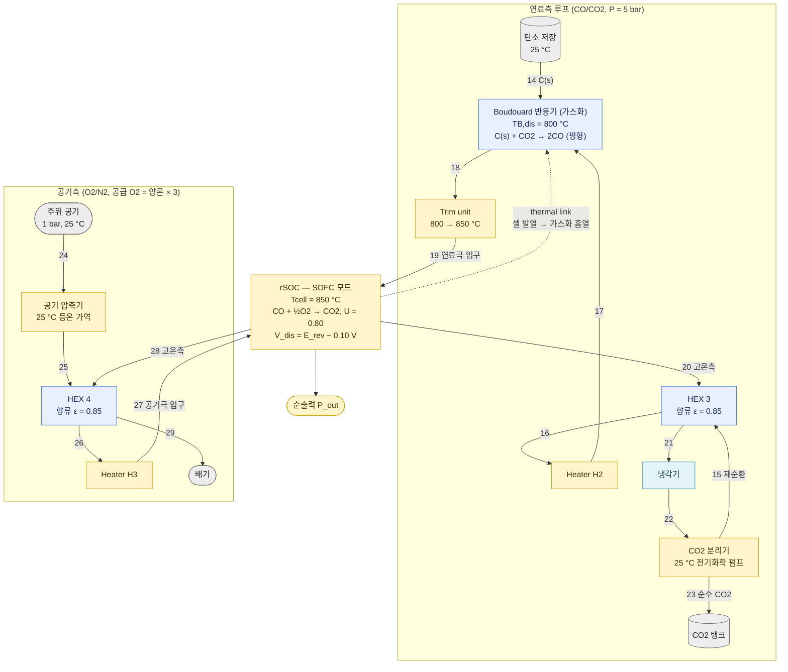

# 시스템 구성도

각 그림은 `.mmd`(Mermaid 원본)에서 그렸고, 보고서·발표용 `.png`(2배 해상도)와 `.svg`를 같이 둡니다.
아래 코드 블록은 깃허브에서 바로 그림으로 보입니다.

## 1. 코드 구조도

`main.m` → 통합 함수 → 충전·방전 모델 → 공통 장치 함수(`system/`) → 물성 함수(`thermo/`) → Cantera 순서로 호출합니다.
파란색은 팀원 3, 초록색은 팀원 1, 주황색은 팀원 2 담당입니다. 점선은 아직 연결되지 않은 부분입니다.

## 2. 충전 모드 공정 흐름도 (Figure 2(a), Stream 1~13)

노란색은 전력을 쓰거나 내는 장치, 하늘색은 냉각기입니다. 화살표 위 숫자는 스트림 번호입니다.

## 3. 방전 모드 공정 흐름도 (Figure 2(b), Stream 14~29)

